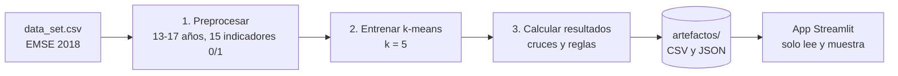

# DSS Salud Escolar · Perfiles de estudiantes (EMSE 2018)

Sistema de soporte para la toma de decisiones que agrupa a los estudiantes de 13 a 17 años según las problemáticas que presentan en conjunto (k-means) y muestra cómo se reparten esos grupos por provincia, edad y sexo. Sirve para decidir **qué acción preventiva llevar a cada provincia y a qué año escolar**.

Trabajo Práctico Final · Sistemas de Soporte para la Toma de Decisiones · Licenciatura en Sistemas · UNPSJB Sede Trelew · 2026.

> **Estado:** MVP funcionando: el pipeline genera los resultados y la app muestra las 4 pantallas. Falta revisarla entre todos y pulirla (ver sección 9).

---

## 1. La idea en una imagen



Hay **dos partes separadas**:

| Parte | Qué hace | Cuándo corre |
|---|---|---|
| **Pipeline del modelo** (`scripts/entrenar.py`) | Preprocesa los datos, entrena el k-means, nombra los perfiles y calcula todas las tablas | Una vez, o cada vez que cambiemos el modelo |
| **App** (`app/`) | Lee esas tablas y las muestra con gráficos | Cada vez que alguien la abre |

### ¿Cómo "consume" la app el modelo?

En este MVP, la app **no entrena ni recalcula nada**. Consume los **resultados del modelo**: el pipeline deja todo calculado en la carpeta `artefactos/` y la app solo lee esos archivos.

La carpeta `artefactos/` es el **contrato** entre las dos partes. Mientras sus archivos tengan las mismas columnas, se puede cambiar el modelo (otro k, otras variables) sin tocar la app: se vuelve a correr `entrenar.py` y la app muestra los resultados nuevos.

Esto cubre lo que el apunte pide de un DSS en cuanto a sus componentes:

| Componente del DSS | Dónde está en el proyecto |
|---|---|
| Gestión de datos | `src/preprocesamiento.py` (filtro de edad, paso a 0/1, faltantes, pesos) |
| Gestión de modelos | `src/modelo.py` (k-means, elección de k, estabilidad) |
| Gestión del conocimiento | `src/reglas.py` (nombre de cada perfil y regla de acción sugerida) |
| Interfaz | `app/` (pantallas en Streamlit) |

---

## 2. Decisiones del MVP

| Tema | Decisión | Por qué |
|---|---|---|
| Lenguaje | Python | Es lo que usamos en las notebooks y lo maneja el grupo |
| App | Streamlit | Todo en Python, poco código, se corre local con un comando |
| Gráficos | Plotly | Gráficos interactivos (pasar el mouse, zoom) y mapa coroplético |
| Modelo | scikit-learn `KMeans` | k = 5, 8 semillas × 50 arranques, con pesos muestrales |
| Uso del modelo | Solo resultados precalculados | Lo más simple para llegar en 2 semanas |
| Navegación | Menú lateral | Las páginas de Streamlit generan el menú solas |
| Mapa | Mapa real de Argentina | El apunte nombra los mapas geográficos entre los recursos de un DSS |
| Gráficos permitidos | Solo los del apunte | KPIs, barras, mapa geográfico, codo y dendrograma |
| Despliegue | Local | Se muestra corriendo en una compu en la presentación |
| Plazo | Menos de 2 semanas | |
| Estilo visual | **Cálido y amigable** | Fondo crema, verde de acento y tipografía Nunito. Se eligió entre 3 propuestas (ver sección 6) |
| Escala del mapa | Divergente de 5 categorías | Compara cada provincia con el país (±5% y ±15%); el corte de 5% es el mismo de la regla de acción |

---

## 3. Estructura del repositorio

```
dss-salud-escolar/
├── README.md
├── requirements.txt
├── .gitignore
├── .streamlit/
│   └── config.toml              # tema de la app (colores y tipografía)
├── data/
│   ├── raw/                     # data_set.csv va acá (NO se sube, ver sección 7)
│   ├── ejemplo/
│   │   └── data_set_falso.csv   # dataset inventado, mismo formato, para probar
│   └── geo/
│       └── provincias.geojson   # contornos de las provincias para el mapa (ya está)
├── notebooks/                   # las notebooks de Colab (exploración y justificación)
│   ├── 01_preprocesamiento.ipynb
│   └── 02_codo_y_kmeans.ipynb
├── src/                         # el código del pipeline, sacado de las notebooks
│   ├── config.py                # variables del modelo, provincias, rutas
│   ├── preprocesamiento.py
│   ├── modelo.py
│   ├── reglas.py                # nombres de perfiles y acción sugerida
│   └── resultados.py            # cruces por provincia, edad y sexo
├── scripts/
│   ├── entrenar.py              # corre todo y genera artefactos/
│   └── generar_dataset_falso.py # arma data/ejemplo/data_set_falso.csv
├── artefactos/                  # salida del pipeline (SÍ se sube)
├── pruebas/
│   └── probar_tema.py           # prueba rápida del entorno, el tema y el mapa
└── app/
    ├── Inicio.py                # punto de entrada: arma el menú y las páginas
    ├── paginas/
    │   ├── resumen.py
    │   ├── perfiles.py
    │   ├── provincias.py
    │   ├── clasificar.py        # usa el modelo entrenado en vivo
    │   └── modelo.py
    ├── componentes/
    │   ├── datos.py             # carga de artefactos (con caché)
    │   ├── estilo.py            # colores del tema y plantilla de Plotly
    │   ├── estilo.css           # tarjetas y detalles visuales
    │   ├── graficos.py          # gráficos de Plotly
    │   └── ui.py                # piezas de HTML: KPIs, tarjetas, referencias
    └── static/
        └── world_110m.json      # mapa base de Plotly, para que el mapa ande sin internet
```

Las páginas están en `app/paginas/` (y no en `app/pages/`) porque el menú se arma a mano en `Inicio.py` con `st.navigation`. Así cada página tiene su título con tildes y su ícono.

La app **no importa nada de `src/`**: solo lee `artefactos/` y `data/geo/`. Así el código del modelo y el de la interfaz quedan separados, y cada uno se puede trabajar por su lado.

---

## 4. El pipeline del modelo

`scripts/entrenar.py` hace en orden lo mismo que las notebooks, pero sin gráficos ni explicaciones:

1. **Preprocesar** (`src/preprocesamiento.py`): estudiantes de 13 a 17 años, provincia desde `stratum`, los 15 indicadores `qn` pasados a 0/1 y solo las filas completas (47.945 de 56.297).
2. **Entrenar** (`src/modelo.py`): k-means con k = 5, 8 semillas × 50 arranques, pesos muestrales. Se queda la solución de menor inercia. También calcula el codo (k de 1 a 10), la silueta y el dendrograma de control sobre una muestra de 4.000.
3. **Nombrar los perfiles** (`src/reglas.py`): reglas sobre los centroides, para que el nombre no dependa del número que el k-means le da a cada grupo.
4. **Calcular resultados** (`src/resultados.py`): porcentaje de cada perfil por provincia, edad y sexo, contexto (padres, hambre) y acción sugerida por provincia. Todo con pesos.
5. **Guardar** en `artefactos/`.

### Artefactos (el contrato con la app)

| Archivo | Qué tiene | Lo usa |
|---|---|---|
| `perfiles.csv` | Nombre, % del país, estudiantes estimados, descripción y acción de cada perfil | Resumen, Perfiles |
| `centroides.csv` | % de cada perfil en cada uno de los 15 indicadores, más el total del país | Perfiles |
| `contexto_por_perfil.csv` | Mujeres, padres que no suelen comprender, hambre | Perfiles |
| `perfiles_por_edad.csv` | % de cada perfil a los 13, 14, 15, 16 y 17 años | Resumen, Perfiles |
| `perfiles_por_sexo.csv` | % de cada perfil en mujeres y varones | Resumen, Perfiles |
| `perfiles_por_provincia.csv` | % de cada perfil por provincia, estudiantes estimados y si el nombre es deducido | Provincias |
| `perfiles_por_provincia_y_edad.csv` | El cruce provincia × edad × perfil | Provincias |
| `acciones_por_provincia.csv` | Perfil que más supera al país, acción sugerida, edad y alcance | Provincias |
| `metricas_modelo.json` | Inercias del codo, silueta, inercia de cada semilla, parámetros | Modelo |
| `dendrograma.json` | Coordenadas del dendrograma y altura del corte | Modelo |
| `modelo_kmeans.joblib` | El modelo entrenado (los 5 centroides), las columnas y el nombre de cada grupo | Clasificar un estudiante |

---

## 5. Pantallas

Cada pantalla responde **una sola pregunta** y tiene pocos elementos, para no cargarla de información.

### Resumen (`paginas/resumen.py`)
**¿Qué perfiles hay y cuántos estudiantes son?**
- KPIs: estudiantes representados, respuestas analizadas, cantidad de perfiles.
- Una tarjeta por perfil con su porcentaje y su acción asociada.
- Barras apiladas de cómo cambian los perfiles con la edad.

### Perfiles (`paginas/perfiles.py`)
**¿Qué tiene cada grupo?**
- Selector de perfil.
- **Barras de los vectores promedio** del perfil contra el total del país, que es como el apunte interpreta los grupos (p. 58-59).
- Barras por edad y por sexo, y el contexto (variables que no entran al modelo).

### Provincias (`paginas/provincias.py`)
**¿Dónde conviene actuar y con qué?**
- Selector de perfil.
- **Mapa de Argentina** con cada provincia pintada según cuánto se aleja del país (escala divergente: un color si está peor, otro si está mejor).
- Ranking en barras de las 24 provincias, con el país como una barra gris más.
- Detalle de la provincia: arriba y en grande la **acción sugerida** (con el porqué), después el perfil elegido en la provincia contra el país, la mezcla de perfiles y el perfil por edad.

### Clasificar un estudiante (`paginas/clasificar.py`)
**¿A qué perfil pertenece un estudiante?**
- Es la única pantalla que **usa el modelo en vivo**: carga `artefactos/modelo_kmeans.joblib`.
- Cada pregunta se responde **Sí, No o Sin dato**: no hace falta completar las 15. El modelo mide la distancia a cada centroide solo en las preguntas respondidas y asigna el perfil más cercano. Con las 15 respondidas da lo mismo que `predict`.
- Se puede cargar un estudiante típico de cada perfil o dejar todo sin dato.
- Muestra la acción sugerida para ese estudiante, cuántas preguntas se usaron, si la asignación es clara o está en el límite entre dos perfiles, el vector (1, 0 o – para sin dato) y la distancia a cada uno de los 5 centroides.
- Sirve para explicar en la defensa cómo funciona el k-means por dentro.

### Cómo se armó el modelo (`paginas/modelo.py`)
**¿Cómo se hicieron los grupos y cuánto podemos confiar?**
- Gráfico del codo y dendrograma con el corte en 5.
- Parámetros, estabilidad entre semillas y silueta.
- Limitaciones (datos de 2018, autorreportados, faltantes no parejos, nombres de provincias deducidos).

### Interacción (para justificar en el informe)
- Elegir el perfil cambia qué se muestra en los gráficos: interacción **activa**.
- Elegir una provincia filtra el detalle: interacción de **steering**.
- Pasar el mouse sobre los gráficos de Plotly: interacción **pasiva**.

### Diseño de referencia
Las 4 pantallas están dibujadas en el canvas [DSS Salud Escolar · Propuestas de estilo](https://claude.ai/artifact/Qymnk9Co6rhz12MT2mvofU), en la fila de abajo. Arriba quedaron las 3 propuestas de estilo que se compararon. Para que el resto del grupo lo vea, hay que compartirlo desde Claude.

Reglas del estilo, para que todas las pantallas se vean iguales:
- Los colores salen de `app/componentes/estilo.py` y del tema en `.streamlit/config.toml`. Nadie escribe un color a mano.
- Cada perfil tiene siempre el mismo color, en todas las pantallas.
- En las barras, la barra es el perfil o la provincia y **la línea oscura es el total del país**.
- En el mapa y el ranking de provincias se usa la escala divergente (naranja: por encima del país, azul: por debajo).
- Los gráficos de Plotly se dibujan con `st.plotly_chart(fig, theme=None)`, para que usen nuestra plantilla y no la de Streamlit.

---

## 6. La regla de acción sugerida

Está en `src/reglas.py` y es la parte de **gestión del conocimiento**:

1. Para cada provincia se compara el porcentaje de cada perfil problemático con el del país.
2. El perfil en el que la provincia más supera al país define la acción:
   - Alcohol sin borracheras o consumo de riesgo → **prevención de consumo**, en primer y segundo año (antes del salto de los 15).
   - Malestar emocional → **salud mental y contención**, en todos los años, con foco en mujeres y en la familia.
   - Violencia entre pares → **convivencia escolar y bullying**, en todos los años.
3. Si ningún perfil supera al país en más de 5%, no hay prioridad marcada.

Es un punto de partida para el equipo que decide, no una orden: la decisión es **no estructurada**.

---

## 7. Datos

- **`data_set.csv`**: archivo nacional de la EMSE 2018 (OMS). **No se sube al repo**, porque pesa 14 MB y tiene sus propias condiciones de uso. Cada integrante lo descarga de la OMS y lo pone en `data/raw/`. Está en el `.gitignore`.
- **`provincias.geojson`** (ya está en `data/geo/`): contornos de las 24 provincias, sacados de Natural Earth, que es de dominio público. Ya viene preparado:
  - la propiedad `provincia` tiene los mismos nombres que usamos nosotros (por ejemplo, `CABA`);
  - las Islas Malvinas están sumadas a Tierra del Fuego;
  - la geometría está simplificada (pesa 119 KB).

  El mapa se dibuja en `componentes/graficos.py` (función `mapa`). Plotly necesita además un mapa base del mundo: lo sirve la propia app desde `app/static/`, así el mapa anda **sin internet**. Las tipografías sí se bajan de Google Fonts; si no hay conexión, se usa la letra del sistema y todo lo demás funciona igual.
- **`data_set_falso.csv`** (en `data/ejemplo/`): 20.000 estudiantes **inventados** con el mismo formato que la EMSE. Sirve para probar el pipeline sin los datos reales y para ver que la app cambia cuando cambian los datos. Lo genera `scripts/generar_dataset_falso.py`: cada estudiante pertenece a un perfil escondido y responde con las probabilidades de ese perfil, con más consumo de riesgo que en la realidad a propósito. Cuando la app muestra resultados del dataset falso, aparece un aviso arriba de todo.
- **Nombres deducidos**: CABA, Formosa, La Pampa, Neuquén, Río Negro y San Luis se deducen del orden del código en `stratum`. Hay que confirmarlos con el informe oficial antes de la entrega.

---

## 8. Cómo correrlo

```bash
git clone <url-del-repo>
cd dss-salud-escolar

python -m venv .venv
# Windows
.venv\Scripts\activate
# Linux / macOS
source .venv/bin/activate

pip install -r requirements.txt

# Abrir la app (los artefactos ya vienen en el repo)
streamlit run app/Inicio.py
```

Para volver a entrenar el modelo (por ejemplo, si cambian las variables en `src/config.py`):

```bash
# 1. Poner data_set.csv en data/raw/
# 2. Generar los artefactos (tarda menos de un minuto)
python scripts/entrenar.py
```

`entrenar.py` muestra el % de cada perfil y avisa si alguno no coincide con lo que dieron las notebooks.

Para probar con el dataset falso (pisa `artefactos/` con resultados inventados):

```bash
python scripts/entrenar.py --datos data/ejemplo/data_set_falso.csv
streamlit run app/Inicio.py          # aparece un aviso amarillo: datos falsos
git checkout -- artefactos           # vuelve a los resultados reales
```

Si algo no anda, `streamlit run pruebas/probar_tema.py` revisa paquetes, tema, GeoJSON y datos, y dice qué falta.

Todos los comandos se corren **parado en la carpeta del repo**, si no Streamlit no encuentra el tema.

`requirements.txt` (al principio sin versiones fijas; cuando todo funcione, se fijan con `pip freeze`):

```
pandas
numpy
scikit-learn
scipy
plotly
streamlit>=1.67
joblib
```

Streamlit va con versión mínima porque el tema usa opciones nuevas (tipografías y colores de los gráficos).

---

## 9. Plan de trabajo (2 semanas)

### Semana 1: que funcione de punta a punta
| # | Tarea | Paquete |
|---|---|---|
| 1 | Crear el repo con la estructura, `.gitignore`, `requirements.txt` y este README | Todos |
| 2 | ~~Pasar las notebooks a `src/` y armar `scripts/entrenar.py`~~ (hecho) | A |
| 3 | ~~Verificar que `entrenar.py` reproduce los números de las notebooks (perfiles 37,1 / 16,1 / 22,4 / 13,3 / 11,0)~~ (hecho, coinciden) | A |
| 4 | ~~Elegir el estilo visual y armar `.streamlit/config.toml`~~ (hecho) | D |
| 5 | ~~Esqueleto de la app: las 4 páginas con el menú y la carga de artefactos~~ (hecho) | B |
| 6 | ~~Conseguir el GeoJSON y probar el mapa~~ (hecho) | C |

### Semana 2: pantallas y pulido
| # | Tarea | Paquete |
|---|---|---|
| 7 | Revisar y pulir las pantallas Resumen y Perfiles (primera versión hecha) | B |
| 8 | Revisar y pulir la pantalla Provincias (primera versión hecha) | C |
| 9 | Revisar y pulir la pantalla Modelo (primera versión hecha) | D |
| 10 | Revisar textos, colores y que cada pantalla responda una sola pregunta | Todos |
| 11 | Probar en la compu de la presentación y sacar capturas para el informe | Todos |

**Paquetes de trabajo**, para repartir entre los 4:
- **A · Pipeline del modelo**: `src/` y `scripts/entrenar.py`.
- **B · Resumen y Perfiles**: `app/paginas/resumen.py`, `app/paginas/perfiles.py`, `componentes/datos.py`.
- **C · Provincias y mapa**: `app/paginas/provincias.py`, GeoJSON.
- **D · Modelo y diseño**: `app/paginas/modelo.py`, `componentes/graficos.py`, `componentes/ui.py`, tema.

### Cómo trabajar con Git (simple)
- Una rama por paquete (`modelo`, `resumen-perfiles`, `provincias`, `modelo-y-diseno`).
- Pull request a `main` cuando una pantalla funcione, y que otro integrante la revise.
- Nadie sube `data/raw/` ni la carpeta `.venv/`.

---

## 10. Fuera del MVP (para después)

Ideas que quedaron afuera para llegar con el plazo (la pantalla "Clasificar un estudiante" ya usa el modelo guardado):
- **Selector de k**: ver cómo cambian los grupos con 4, 5 o 6 perfiles.
- **Cargar datos nuevos**: subir un CSV con el mismo formato y asignar un perfil a cada estudiante.
- **Publicarla online** (por ejemplo, en Streamlit Community Cloud).

---

## 11. Pendientes

- [x] Elegir el estilo visual entre las propuestas (cálido y amigable).
- [x] Conseguir el GeoJSON de provincias y revisar los nombres.
- [ ] Confirmar los nombres de las 6 provincias deducidas.
- [ ] Definir quién toma cada paquete de trabajo.
